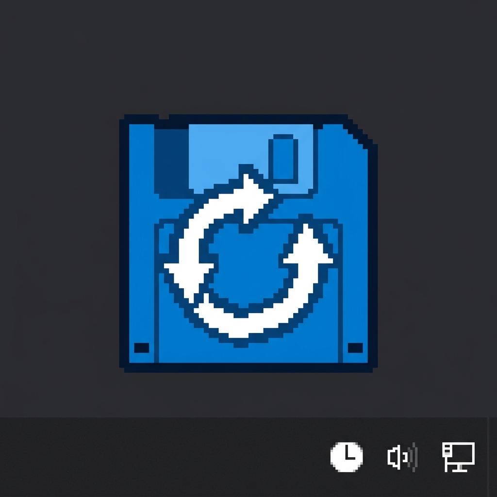

<p align="center">
  
</p>

# Dune 🏜️ — Game Save Sync Ecosystem (Monorepo)

**Dune** is a complete game-save management ecosystem: an Electron desktop client, an Express + tRPC server, and shared TypeScript contracts — all in one monorepo with npm workspaces.

```
dune/
├── packages/
│   ├── client/   # @dune/client — Electron + React + Vite desktop app
│   ├── server/   # @dune/server — Express + tRPC API, Dockerized
│   └── shared/   # @dune/shared — Game, Settings, ElectronAPI, Playtime, Achievements, HLTB types
├── docker-compose.yml   # server stack (Ollama runs on the host by default)
├── deploy.sh            # install / build / test / up / logs
└── package.json         # workspaces root
```

## Quick Start

```bash
# 1. Install all workspaces
./deploy.sh install
# or: npm install

# 2. Build shared → server → client
./deploy.sh build

# 3. Run tests
./deploy.sh test

# 4. Start production stack (server :3023)
./deploy.sh up
```

- Server API: `http://localhost:3023` · tRPC: `http://localhost:3023/trpc` · Health: `http://localhost:3023/health`
- Client dev: `npm run dev --workspace=@dune/client`
- Server dev: `npm run dev --workspace=@dune/server`

## Packages

| Package | Stack | Purpose |
|---------|-------|---------|
| `@dune/client` | Electron 44, React 19, Vite 8, TS 6 | Desktop app: save mapping (Win/Linux paths), auto-detect via ludusavi manifest + Wine prefixes, cloud sync/restore with progress, Playtime + Achievements + HLTB tabs, SteamGridDB art, toasts, tray/background mode |
| `@dune/server` | Express 5, tRPC 11, Zod 4, TS strict | Save sync API (streaming upload, versioning, SQLite DB via `node:sqlite`), playtime/achievements/HLTB services, Ollama AI analysis, SteamGridDB proxy, local dual-boot sync, remote replication, API-key auth, rate-limit, helmet, CORS |
| `@dune/shared` | TypeScript only | Single source of truth: `Game`, `Settings`, `ElectronAPI` (full IPC contract), `PlaytimeSession/Summary`, `Achievement/Summary`, `HLTBTimes`, `APIResponse`, `SyncProgress` |

## Features

- **Save sync with versioning** — per-file streaming upload (`x-game`/`x-path`/`x-sync-id` headers), `.versions/{timestamp}/` snapshots, `maxVersions` pruning, `saves.zip` auto-extract
- **tRPC + Zod** — end-to-end type safety; breaking API changes fail at compile time, not runtime
- **Playtime tracking** — `POST /trpc/playtime.record`, summaries, recent sessions, totals
- **Achievements** — per-game lists, summaries, recent unlocks, Sentinel webhook
- **HLTB** — completion times with 7-day file cache + bulk fetch
- **AI file analysis** — Ollama (`phi4-mini` default) classifies Save/Config/Cache/Other
- **Security** — API-key auth, 100 req/15min + 20 uploads/min rate limits, helmet CSP, CORS allowlist, path-traversal guards, atomic writes
- **278 unit tests** — path utils, scanner, playtime, achievements, HLTB, SQLite DB, security, tRPC + REST shims (Vitest, 80% coverage gate), plus 5 Playwright smoke tests for the dashboard renderer and ESLint over both workspaces
- **Server dashboard** — dependency-free single-file admin UI at `/`: sticky tab rail (Overview / Games / Users / API keys / Settings) with hash routing, Lucide-derived inline SVG icons, status tiles with semantic tones, empty states with next-step hints, per-card errors surfaced as toasts, and parallelised per-game fetches (was serial N+1)
- **Desktop UI** — Lucide-derived inline icon set (no new runtime dep), sidebar library stats, search icon, toast icons, empty states with CTAs, and the previously-unstyled sync-progress / stat-card classes filled in
- **Docker** — multi-stage build (Node 22), non-root user, tini, healthcheck; Ollama is expected on the host (or point `ollamaEndpoint` at any reachable instance)

## Development

```bash
npm install                  # all workspaces
npm run build --workspaces   # shared → server → client
npm run lint                 # ESLint (flat config) over server + client
npm run test --workspace=@dune/server
npm run test:e2e --workspace=@dune/client   # Playwright smoke tests (build client first)
npm run dev --workspace=@dune/server   # :3030
npm run dev --workspace=@dune/client   # vite dev
```

## Deployment

```bash
./deploy.sh docker:build
./deploy.sh up      # server stack
./deploy.sh logs    # follow server logs
./deploy.sh down
```

Data persists in `./data` (mounted to `/app/backend/data`). Configure SteamGridDB key + Ollama endpoint in server Settings or via API.

## UI & design skills

The repo ships a curated set of agent skills under `.cursor/skills/` (project-local, gitignored) covering UI/UX, accessibility, color theory, responsive design, and Dune-specific architecture. The frontend skills used for this rehaul were also installed from `hueyexe/frontend-agent-skills` via `npx skills@latest add …` into `.agents/skills/` (gitignored, pinned by `skills-lock.json`):

```bash
npx skills@latest add hueyexe/frontend-agent-skills --all --copy   # 9 frontend UX/UI skills
```

Icons are inline SVG derived from [Lucide](https://lucide.dev) (ISC licence) — no icon runtime dependency is added to either bundle; the geometry lives in `packages/client/src/Icon.tsx` and the dashboard's inline sprite.

## Migration Notes

This monorepo consolidates the former `dune` (client), `dune-server`, and `dune-shared` repositories. Git history for the client is preserved via `git mv`; server/shared were copied in (their histories remain in the archived repos).
